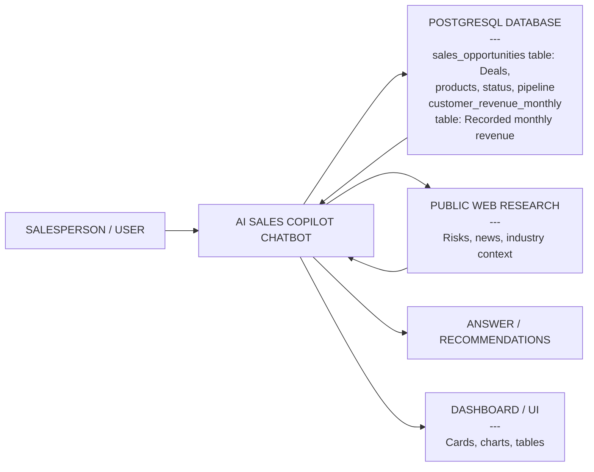

# Hackathon: AI Sales Copilot

**English-language chatbot**

Build a chatbot that helps a sales team understand customer revenue, prioritize
deals and take safe actions using PostgreSQL, web research and a dashboard.

## Use case at a glance

The salesperson asks a question in chat. The copilot queries the database for
sales figures, uses public web research when external context is needed, and
returns an answer together with useful cards, charts or tables. Deal changes
go through a preview and explicit confirmation before being saved.

This diagram shows the main interactions, not a required technical architecture.
Database and search access should go through controlled backend tools, not
unrestricted access by the model.

## What to build

**Database setup:** import both supplied CSV files into a relational database,
such as PostgreSQL. The application must query that database and persist
confirmed deal updates there, rather than use the CSV files directly as its
runtime data store. Include database setup and import steps in your instructions.

1. **Analyze and prepare:** help a salesperson prepare for a customer meeting.
   Summarize our recorded revenue from the account, open opportunities and past
   Won/Lost proposals. Support comparisons by period, product and cluster.
   Recommend three Active deals to prioritize, backed by figures and a rationale.
2. **Research and recommend:** add relevant public company or industry context,
   including cybersecurity, service continuity, technology lifecycle or
   regulatory risks. Cite sources and dates. Turn the findings into discussion
   topics, discovery questions and possible next steps for the customer meeting,
   not just a list of news articles.
3. **Update:** preview allowed deal changes and ask for confirmation before
   saving. Cancellation must perform no write.
4. **Generate and adapt the UI through chat:** turn natural-language requests
   into relevant tables, charts and summary cards, not just text answers or
   filters on a fixed dashboard. Dynamically compose the view using predefined
   components and validated settings, rather than executing arbitrary
   AI-generated code. Let users refine the layout, filters, sorting and chart
   types through follow-up prompts. Refresh affected components after saved
   deal edits without reloading the page.

## The business context

Imagine a telecom sales team selling internet connectivity, cloud services,
security and workplace tools to business customers. Account managers understand
customers' needs, prepare offers, negotiate contracts and follow up on renewals.
For example, a manufacturer might need internet connections for several sites,
firewall management and mobile plans for its employees.

An **opportunity** is a potential deal: **Active** means undecided, **Won** means
accepted, and **Lost** means the proposal is not proceeding.
A deal can contain several product lines but still counts as one opportunity.
A **renewal** continues an existing arrangement; **upsell** expands its scope.
**Pipeline** is potential deal value; **revenue** is money already recorded.
Winning a deal does not mean all its value has already become revenue.

## Research: what risks to look for

Focus on risks relevant to the selected customer or industry, not generic bad news:

| Risk area | Examples | Possible sales follow-up |
| --- | --- | --- |
| Cybersecurity | Phishing, ransomware, exposed systems or industry-specific attack trends. | Discuss an assessment, Email Security, Endpoint Protection or Security Operations Monitoring. |
| Service continuity | Network outages or dependence on a single connection. | Review connectivity resilience and whether 5G Business Backup or Managed SD-WAN Site fits the customer's needs. |
| Technology lifecycle | Hardware or software reaching end of support. | Discuss a Cloud Migration Workshop or a Managed Laptop Standard refresh. |
| Regulatory change | New privacy, data-location or industry requirements. | Clarify requirements with the customer's specialists before proposing service changes. |

For each risk, provide **evidence, source URL, publication/update date, access
date, possible customer impact and a concrete next step**. State when a source
date is unavailable. Prefer primary sources such as regulators, vendors and
official advisories; flag evidence published after the dataset's reference date.

Separate what a source establishes from what you infer. An industry risk does
not prove that a particular customer is affected. The dataset contains no
technical inventory or compliance evidence: do not invent exposure, promise
that a product solves the problem, or claim it guarantees compliance.

## Data

**SIMULATION: real company names, invented business data.**
The names identify 30 example accounts only. Deals, IDs, prices, outcomes and
revenues are simulated, not actual company figures or evidence of a supplier
relationship. Distribute this disclaimer with the CSVs.

**30 company labels, 2,000 deals, 5,102 product lines and 14,400 revenue records.**

- [sales_opportunities.csv](sales_opportunities.csv): one row per product line;
  prices are net **12-month service values**, or the full fee for a one-off item.
- [customer_revenue_monthly.csv](customer_revenue_monthly.csv): one row per
  customer, month and service cluster; simulated recorded net EUR revenue.
- Period: **November 2016 to October 2026**. Reference date: **2026-10-31**.
- Clusters: **Connectivity, Cloud Services, Security, Workplace & Communications**.

**Revenue matches the initial Won opportunities:** service starts the month
after `close_date`. Recurring lines contribute 1/12 of their value each month
for 12 months. `Cloud Migration Workshop` and `Security Assessment` contribute
their full fee once, in that first month. Active/Lost contribute nothing.
Amounts scheduled after October 2026 are future revenue, not historical revenue.
There are no opening contracts, arbitrary revenue noise or credit adjustments.

## Design for millions of rows

This is a small simulation for easy setup. **Design the application as if each
table contained millions of records**, as a real sales system might. A solution
that works only because the supplied dataset fits in memory is not sufficient.

- Perform filtering, joins, sorting and aggregation in PostgreSQL, not by
  loading entire tables into application memory, the browser or an LLM prompt.
- Return only the required columns and bounded results. Paginate large tables
  and send the model compact query results, not the full dataset.
- Use appropriate indexes and query timeouts. A result limit alone does not
  make an expensive query safe; consider how much data the database must process.
- Fetch and refresh only the data needed by affected components. Handle slow
  queries and failures explicitly rather than freezing the UI or silently
  returning incomplete answers.

## Field guide

IDs are text, dates use `YYYY-MM-DD`, and amounts are net EUR with a decimal
point. An empty `closed_lost_comment` means NULL, not a missing loss reason for
an Active or Won deal. All other fields are populated.

### `sales_opportunities.csv`

One row represents one product line. All lines of a deal share the same
deal-level values; only `product_name`, `cluster` and `total_price_eur` may differ.

| Field | Meaning |
| --- | --- |
| `source_opportunity_number` | Unique deal ID, repeated across its product lines. Use it to identify a deal or count distinct deals. |
| `business_partner_number` | Invented customer/account ID. The join key to revenue; not a real company registration number. |
| `business_partner_name` | Real company or brand name used as a label for the simulated account. |
| `product_name` | Service offered on this line, such as Business Fiber 500 or Email Security. A line may cover multiple units; quantities are already included in its value. |
| `cluster` | Product category: Connectivity, Cloud Services, Security, or Workplace & Communications. |
| `total_price_eur` | This line's full net proposal value: 12 months for recurring services, or the full one-off fee. Not a unit price or a monthly amount. |
| `order_entry` | Full net contract/proposal value in EUR: the sum of `total_price_eur` across all lines with the same `source_opportunity_number`. Repeated identically on every line of the deal, including across clusters. Populated for Active, Won and Lost; it is not recorded revenue. Read-only. |
| `won_lost_active_status` | Current deal outcome: Active, Won or Lost. Losing one proposal does not necessarily mean losing the customer. |
| `phase_label` | Sales stage at the snapshot: Discovery, Solution design, Proposal, Negotiation, Closed won or Closed lost. Read-only; after edits, use current status rather than this snapshot stage to identify open deals. |
| `win_probability_percent` | Estimated chance of winning, as a whole percentage. Active: 0–99; Won: 100; Lost: 0. Weighted pipeline is Active value multiplied by probability / 100, not a calibrated forecast. |
| `opportunity_created_at` | Date the opportunity was created. Not the service start date. |
| `close_date` | Expected decision date for Active deals; simulated decision date for initially Won/Lost deals. Initial Won revenue starts the following month. An overdue Active date does not automatically mean Lost. |
| `opportunity_type` | New Business introduces new scope, Renewal continues an arrangement, and Upsell expands scope. New Business does not necessarily mean a brand-new customer. |
| `closed_lost_comment` | Simulated explanation for a Lost outcome. Required and nonblank for Lost; NULL for Active/Won. Not a factual statement about the named company. |

### `customer_revenue_monthly.csv`

One row represents one customer, calendar month and cluster. All combinations
exist, including zero-revenue months.

| Field | Meaning |
| --- | --- |
| `business_partner_number` | The same simulated account ID used in opportunities. |
| `year` | Calendar year. The first and last years cover only part of the year. |
| `month_num` | Calendar month, 1–12. Combine with `year` when grouping or sorting. |
| `revenue_monthly` | Simulated service revenue recorded for this account, month and cluster, derived from initial Won lines. Not the named company's own reported turnover. Zero means no scheduled revenue. |
| `cluster` | The service category. Sum the four clusters for total monthly revenue per customer. |

## Typical sales workflows to support

The examples below adapt common sales-assistant requests to this exercise.
They are illustrative conversations, not scripts to hard-code. Keep the selected
customer, period and filters across follow-up questions; ask for clarification
when the intended scope is ambiguous.

### 1. Prepare for a customer meeting

- **Start:** "Prepare me for a sales meeting with Siemens. Show our recorded
  revenue from this account for January–October 2026, the monthly trend, and
  its current open opportunities."
- **Follow up:** "Break the revenue down by cluster. Which products appear in
  its Won and Lost opportunities since January 2024?"
- **Then:** "Suggest three discussion topics and five discovery questions based
  on these figures and relevant public company or industry information."

**Expected:** generate an account briefing with revenue summary cards, a monthly
chart and a deal table. Keep internal simulated figures separate from cited
external facts and from recommendations. Opportunity history is evidence of
proposals, not a verified inventory of the customer's current installed services.

### 2. Review and prioritize the open pipeline

- **Start:** "Show the Active pipeline by cluster, with both unweighted and
  probability-weighted value and the number of distinct deals."
- **Follow up:** "Show the five largest Active Security deals by full-deal value,
  including probability and expected close date."
- **Then:** "Which three Active deals should I focus on, and why? Highlight any
  overdue expected close dates."

**Expected:** generate a pipeline overview and drill-down table. Label whether
cluster values include only matching product lines or the full value of matching
deals. Explain the prioritization rule; do not present weighted pipeline as
guaranteed revenue.

### 3. Understand account performance and past outcomes

- **Start:** "Which five customers generated the most recorded revenue for us
  in 2025? Show their revenue by cluster."
- **Follow up:** "For those same customers, compare January–October 2026 with
  January–October 2025, including the absolute and percentage change."
- **Then:** "Which customers have declining revenue in Q3 2026 versus Q2 2026
  and also have Active renewal opportunities?"
- **Another drill-down:** "Show Volkswagen's Won and Lost Cloud Services
  opportunities closed between 2022 and 2025, with values and loss comments."

**Expected:** comparable periods, distinct deal counts and separate customer-level
aggregations before joining revenue to opportunities. Use `close_date` for the
requested closed-deal history, not creation date. Show an undefined percentage
change explicitly when the comparison base is zero. Loss comments describe
simulated outcomes, not verified causes of a real company's behavior.

### 4. Find a relevant next conversation

- **Start:** "Review Siemens's opportunity history and suggest two products
  from our catalog that would be worth discussing next. Explain the evidence
  and what we still need to ask the customer."
- **Follow up:** "Research cybersecurity risks affecting manufacturers. Cite
  sources and dates, and turn the findings into a short meeting agenda."

**Expected:** connect evidence to a plausible sales conversation and discovery
questions. A product absent from the database is not proof that the customer
does not use it or buys it elsewhere. Distinguish our simulated account revenue
from the company's own public turnover; do not substitute one for the other.

### 5. Generate a view, refine it and safely change a deal

- **Start:** "Build a dashboard with Active pipeline summary cards, a monthly
  revenue chart for January–October 2026, and a table of Active opportunities."
- **Follow up:** "In the opportunity table, show only Security deals and sort by
  full-deal value. Change the revenue chart to a line chart and hide the weighted
  pipeline card."
- **Then:** "Set opportunity 990600001's win probability to 60 percent."
  Review the preview and explicitly **confirm**.
- **Cancellation test:** "Move opportunity 990600001's close date to 2026-12-15."
  Then **cancel at the confirmation step**, as explained below.

**Expected:** compose and update real UI components, not just describe a
dashboard in text. The table filter must not silently change the revenue chart's
scope. Save the probability on every product line of the deal, including lines
hidden by the Security filter, and refresh affected data without a page reload.
The cancelled date change must perform no write.

### Stay within the available data

The two tables do not contain contacts, account-manager ownership, addresses,
site counts, installed equipment, service usage, actual contract expiry dates
or a corporate group hierarchy. Do not invent these or add integrations as a
requirement. Explain the limitation and offer an answer supported by the data.
`close_date` is a deal decision date, not a contract expiry date.

These workflows illustrate the four core tasks; they do not require extra
features such as email sending, PowerPoint/PDF export or access to internal
company systems. Never copy production conversations, personal details or
internal identifiers into the public app or demo.

### Cancellation example: preview, then discard

This tests cancellation **before saving**, not undoing an already saved change:

1. **User:** "Move opportunity 990600001's close date to 2026-12-15."
2. **Chatbot:** read the current date and preview the proposed change, including
   the deal ID and number of affected product lines. Ask "Confirm or cancel?"
   **Do not write to the database yet.**
3. **User:** "Cancel."
4. **Chatbot:** discard the pending change and report "Cancelled. No changes
   were saved." Every line must retain its previous close date.

In the demo, show that the stored values remain unchanged. Do not implement
cancellation as saving the new date and then restoring the old one. Any earlier,
separately confirmed edits must also remain intact.

## Deliver and demo

Deliver a working chatbot, setup instructions and a short demo showing:
**a database answer, three recommended deals, cited research, a confirmed update,
a cancelled update, a chat-driven UI change and refresh after saving**.
Present these as a short connected sales workflow, for example meeting
preparation followed by a drill-down, generated UI and a confirmed deal edit.
Include a follow-up question to demonstrate that conversational context is kept.

## Judging criteria

| Area | What we will evaluate | Points |
| --- | --- | ---: |
| System architecture | Clear responsibilities for the LLM, backend, database and UI; sensible technical choices, error handling and a design that can scale to millions of records. | 20 |
| Usability | An intuitive chat and dashboard, clear answers, understandable confirmations and error messages, and a smooth workflow for sales users. | 20 |
| Creativity | Original, useful ideas for applying AI and presenting insights that make the sales workflow better, rather than adding complexity for its own sake. | 20 |
| Presentation and demo | A clear explanation of the solution, a working demo, and the team's ability to explain its decisions, limitations and trade-offs. | 40 |
| **Total** | | **100** |

You may use different LLM models depending on availability. Judging will
therefore consider not only the final output, but also the team's **AI and
engineering thinking behind the solution**: how well the team designs the
architecture, uses the database safely and efficiently, handles confirmations
and cancellations, explains limitations, and builds a useful sales workflow.
Make these choices and trade-offs visible in your presentation and demo.